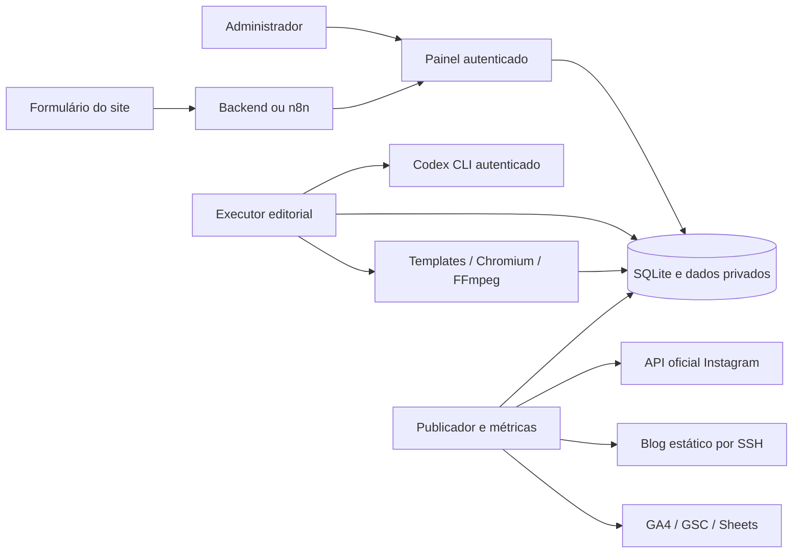

# Arquitetura e pontos de extensão

- `app.py`: API HTTP, login scrypt, sessão assinada, CSRF, aprovações e painel. Um administrador por instalação.
- `brand.py`: configuração privada validada e atômica em `/data/brand.json`; inclui contexto, identidade, preferências dos agentes, horários e IDs públicos de integrações.
- `creative_pipeline.py`: grafo LangGraph, saída JSON validada, checkpoints SQLite, ambiente reduzido no Codex e templates controlados. Nenhum HTML ou comando gerado pelo modelo é executado.
- `creative-engine/.agents/skills`: oito funções especializadas. Preferências do operador são anexadas à direção da marca; regras de segurança não são desativáveis por brief.
- `library.py`: elementos originais iniciais, uploads raster validados e sem EXIF, logo e configuração para renderização. Arquivos privados ficam no volume.
- `editorial_calendar.py`: reserva antes da aprovação, horários alternados e reprogramação. Meta padrão de uma peça por canal/dia, incluindo fins de semana.
- `scheduler.py`: editorial/radar/relatório; publisher/blog/Instagram/Google. Papéis separados, heartbeat e retomada; deploy padrão não exige cron externo.
- `blog_builder.py` e `hosting_upload.py`: HTML estático, fontes, sitemap do blog, pinagem SSH, backup e hashes.
- `leads.py` e `google_sync.py`: contatos criptografados, deduplicação, status/pagamentos e APIs Google com escopo limitado.
- `marketing_learning.py`: contexto agregado para agentes, sem PII. Amostra pequena não elege vencedor.
- `tracking/cml-track.js`: consentimento, eventos explícitos e atribuição sanitizada no domínio do site. Não contém segredo de backend.

## Extender

Para outro CMS, adicione um adaptador de publicação mantendo aprovação e idempotência; não marque publicado antes de confirmar no destino. Para nova rede, implemente autenticação oficial, upload/outbox e métricas. Não use automação de senha/scraping para contornar APIs. Para multiusuário/multicliente, implemente autorização por recurso e isolamento antes de oferecer como SaaS; trocar somente o logo não fornece esse isolamento.

Datas são guardadas em UTC; calendário usa o fuso configurado. Interface administrativa em português; idioma do conteúdo é uma preferência. Rótulos internos `enrollment` e `paid_enrollments` significam conversão/venda paga nesta edição e foram mantidos no esquema para estabilidade, sem especialização por segmento.
